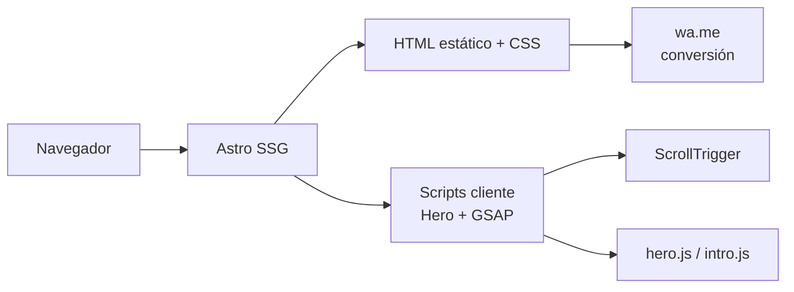
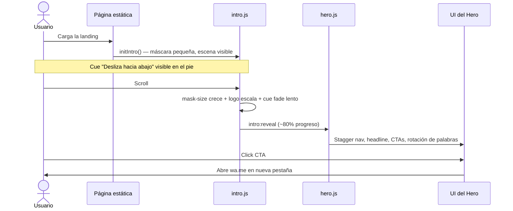
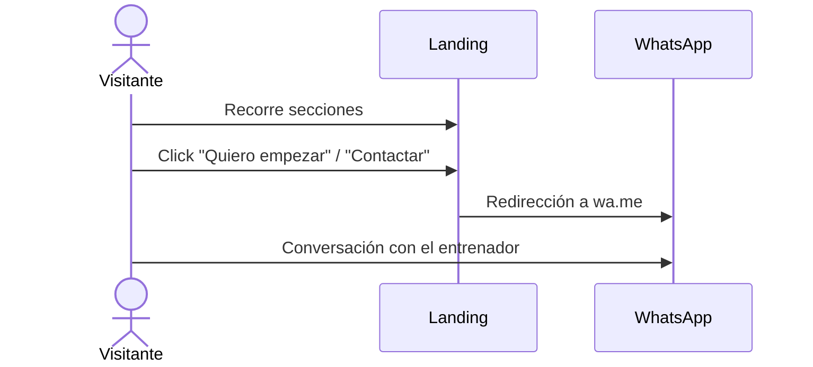

# Active Club — Landing Page

> Landing estática de una página para asesoría personalizada de entrenamiento físico. Convierte visitas en conversaciones por WhatsApp.


---

## 1. Project Overview

Active Club ofrece entrenamiento personalizado basado en evidencia, presencial y virtual. Esta landing comunica la propuesta de valor, genera confianza y dirige al usuario a iniciar una conversación por WhatsApp.

No hay registro, pagos ni formularios en la página. El único canal de conversión es un enlace a `wa.me`. El proyecto prioriza rendimiento, SEO y una experiencia visual editorial con animaciones de scroll de alta calidad.

**Estado actual:** la sección Hero está implementada con intro enmascarada (revelación del logo al scrollear). El resto de secciones están planificadas en `docs/PROJECT_CONTEXT.md`.

---

## 2. Architecture Overview

### Diagram



### Architecture Decisions

#### ADR-001: Astro como generador estático

- **Decisión:** La landing se construye con Astro y se publica como HTML estático.
- **Contexto:** El sitio es contenido de marketing sin lógica server-side, pero necesita SEO fuerte y carga rápida; un SPA completo añadiría JS innecesario en la mayoría de secciones.
- **Consecuencias:** Se obtiene HTML listo para indexar y TTFB bajo. Se acepta que las animaciones viven en scripts cliente aislados y no en un framework reactivo global.

#### ADR-002: GSAP solo en el cliente, modularizado por sección

- **Decisión:** Las animaciones corren en `<script>` del componente Hero, con `gsap.config.js` como punto único de registro de plugins.
- **Contexto:** GSAP no puede ejecutarse en el servidor y la intro del Hero depende de ScrollTrigger con pin y scrub; mezclar animación global dificulta el mantenimiento cuando cada sección evoluciona por separado.
- **Consecuencias:** Cada sección controla su propio ciclo de vida. El costo es coordinar eventos custom (`intro:reveal`) entre `intro.js` y `hero.js` en lugar de un store centralizado.

#### ADR-003: Intro del Hero con máscara CSS invertida

- **Decisión:** La revelación inicial usa `mask-image` sobre una escena con foto de fondo, inspirada en referencias tipo GTA VI pero con la máscara creciendo en lugar de encogerse.
- **Contexto:** El Hero debe impactar en menos de cinco segundos y reforzar la identidad de marca antes de mostrar el contenido editorial; un fade simple no diferencia la experiencia.
- **Consecuencias:** La intro es memorable y coherente con el logo vertical. Se acepta más complejidad en CSS y GSAP, y la necesidad de retirar la máscara antes de que los huecos tipográficos del SVG se noten al escalar.

#### ADR-004: Dark-first con tokens semánticos

- **Decisión:** La interfaz parte de fondo oscuro y tokens CSS (`--color-cta-primary`, `--color-text-on-dark`, etc.) en lugar de colores hardcodeados.
- **Contexto:** La guía de marca define paleta y tipografía propias; sin tokens, cada sección repetiría valores y rompería consistencia al escalar la landing.
- **Consecuencias:** Cambios de marca se propagan desde `tokens.css`. Las fuentes licenciadas aún no están disponibles; se usan sustitutos de Google Fonts hasta el deploy final.

---

## 3. Scope & Boundaries

### En scope

- Landing de una sola página en español
- Comunicación de propuesta de valor, método, perfiles, entrenador y proceso
- CTAs que abren WhatsApp con mensaje predefinido
- Animaciones de scroll con GSAP (Hero implementado)
- SEO básico: meta tags, Open Graph, HTML semántico
- Diseño responsive y accesibilidad razonable (focus visible, `prefers-reduced-motion`)

### Fuera de scope

- Formularios, registro de usuarios o backend propio
- Pasarelas de pago o suscripciones
- Panel de administración o CMS
- Analytics integrado (puede añadirse después sin cambiar la arquitectura)
- Chat embebido — la conversación ocurre en WhatsApp

### Extensiones futuras

- Secciones 2–8 definidas en `docs/PROJECT_CONTEXT.md` (Problema, Método, Entrenador, etc.)
- Header fijo, footer global y FAB flotante de WhatsApp
- Fuentes de marca (`TT First Neue`, `Made Outer Sans`) cuando estén licenciadas
- Dominio real en `astro.config.mjs` para canonical y sitemap

---

## 4. Tech Stack

| Tecnología | Versión | Rol | Por qué |
|---|---|---|---|
| Astro | 6.x | Framework SSG | HTML estático por defecto; ideal para landings con poco JS |
| Tailwind CSS | 4.x | Estilos | Utilidades con build integrado vía Vite; sin CSS muerto |
| GSAP | 3.x | Animaciones | ScrollTrigger, pin y scrub para la intro del Hero |
| TypeScript | 6.x | Tipado | Soporte en Astro y chequeo con `@astrojs/check` |
| pnpm | — | Paquetes | Instalación rápida y manejo estricto de dependencias |
| Node.js | ≥ 22.12 | Runtime | Requerido por Astro 6 |

**Deploy previsto:** Vercel, Netlify o Cloudflare Pages — el output en `dist/` es estático sin configuración especial.

---

## 5. Project Structure

```text
active-club-landing/
├── public/                      # Assets con URL fija (máscaras SVG para mask-image)
│   ├── logo-vertical-mask.svg   # Silueta del logo para la intro del Hero
│   └── logo-mask.svg            # Imagotipo horizontal (reserva / docs)
├── src/
│   ├── assets/
│   │   ├── images/              # Fotos, logos vectoriales, logotipos de marca
│   │   └── icons/               # Íconos outline para secciones futuras
│   ├── components/
│   │   ├── sections/            # Secciones de la landing (Hero, Método, etc.)
│   │   └── ui/                  # Piezas reutilizables (Button, FAB)
│   ├── layouts/
│   │   └── BaseLayout.astro     # <head> SEO, fuentes, anti-FOUC
│   ├── pages/
│   │   └── index.astro          # Punto de entrada — ensambla secciones
│   ├── scripts/
│   │   └── animations/          # GSAP por dominio: intro, hero, scrollReveal
│   └── styles/
│       ├── tokens.css           # Design tokens de marca
│       └── global.css           # Base, tipografía, utilidades globales
├── docs/
│   └── PROJECT_CONTEXT.md       # Decisiones de producto, branding y secciones
├── astro.config.mjs
└── package.json
```

La organización separa **markup estático** (`.astro`) de **comportamiento** (`scripts/animations/`) para que cada capa evolucione sin acoplar estilos con timelines de GSAP.

---

## 6. Data Flow

### Flujo de la intro del Hero



### Flujo de conversión (objetivo final)



---

## 7. Setup & Installation

### Requisitos previos

- Node.js >= 22.12.0
- pnpm (recomendado) o npm

### Instalación

```bash
git clone https://github.com/carlosqm-dev/active-club-landing.git
cd active-club-landing

pnpm install
pnpm dev
```

La app queda en `http://localhost:4321`.

### Scripts disponibles

| Comando | Descripción |
|---|---|
| `pnpm dev` | Servidor de desarrollo con HMR |
| `pnpm build` | Build de producción en `dist/` |
| `pnpm preview` | Preview del build local |
| `pnpm astro check` | Chequeo de tipos Astro/TS |

---

## 8. Environment Variables

No hay variables de entorno obligatorias en esta etapa. El enlace de WhatsApp está centralizado como constante en los componentes (`WHATSAPP_URL = "#contacto"` hasta tener el número real).

Cuando se configure el número de producción, conviene externalizarlo:

| Variable | Requerida | Descripción | Ejemplo |
|---|---|---|---|
| `PUBLIC_WHATSAPP_NUMBER` | Sí (prod) | Número sin `+` para construir `wa.me` | `573001234567` |

---

## Documentación adicional

- [docs/PROJECT_CONTEXT.md](./docs/PROJECT_CONTEXT.md) — branding, paleta, estructura de secciones y especificación del Hero
- Commits en [Conventional Commits](https://www.conventionalcommits.org/) en español (`feat(hero): …`, `chore(animaciones): …`)
